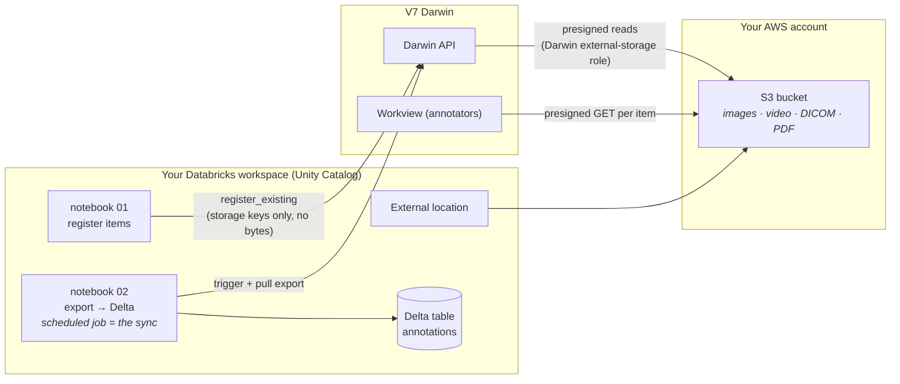

# V7 Darwin ↔ Databricks Integration

Connect [V7 Darwin](https://www.v7labs.com/) (annotation platform) to Databricks
(system of record): register files governed by Unity Catalog into Darwin **in
place** — no bytes are copied — and sync annotations back as a typed **Delta
table** on a schedule.

> **Note:** this repository replaces the old `darwinpyspark` pip package, which
> is deprecated and no longer maintained. There is nothing to `pip install`
> from here — you configure credentials, run one setup script, and use the
> notebooks/jobs directly.

## Architecture



- **Your files never leave your bucket.** Darwin accesses them just-in-time via
  presigned URLs using its external-storage IAM role, granted by your bucket
  policy (and KMS key policy if encrypted).
- **Annotations land as one Delta row per annotation** with the bbox/polygon
  payload as JSON, class name, annotator/reviewer authorship, Darwin's
  per-annotation `updated_at`, and the export release name.
- **The sync is idempotent and change-aware**: re-runs MERGE on
  `(item_id, annotation_id)` and only update rows whose Darwin `updated_at`
  changed — unchanged rows keep their original `ingested_at`.

## Prerequisites

1. A **Databricks workspace** with Unity Catalog, a SQL warehouse, and an
   **external location** covering your S3 path
   ([docs](https://docs.databricks.com/en/connect/unity-catalog/external-locations.html)).
2. A **V7 Darwin team** with:
   - an [external storage integration](https://docs.v7labs.com/docs/aws-s3-configuration)
     pointing at the same bucket (`./scripts/create_storage_integration.sh` can
     create it for you once the bucket policy is in place);
   - a **team-scoped API key** (Settings → API keys) with dataset permissions.
3. Bucket policy (and KMS key policy for encrypted buckets) granting Darwin's
   external-storage role — see
   [V7's S3 configuration guide](https://docs.v7labs.com/docs/aws-s3-configuration).
   `terraform/` in this repo contains a complete, working example (bucket +
   customer-managed KMS key + policies).
4. Locally: the [Databricks CLI](https://docs.databricks.com/en/dev-tools/cli/index.html)
   (authenticated) and `bash`.

## Quickstart

```bash
git clone https://github.com/v7labs/darwinpyspark.git
cd darwinpyspark
cp .env.sample .env
# fill in .env (Darwin API key, team, Databricks profile/warehouse, S3 path, …)
./scripts/setup_databricks.sh
```

The setup script (idempotent, re-run any time) will:

1. store your Darwin API key in a **Databricks secret scope** (it is never
   written to the workspace in plain text);
2. create the target schema for the annotations table;
3. import the two notebooks into your workspace (default `/Shared/v7-darwin`);
4. create two jobs pre-wired with your `.env` values:
   - **`v7-darwin-register`** — registers new files from your S3 path into
     Darwin (incremental: already-registered files are skipped);
   - **`v7-darwin-export-sync`** — exports annotations into your Delta table
     (optionally on a cron schedule via `SYNC_SCHEDULE_CRON`).

Then:

1. Run **`v7-darwin-register`** → your files appear in Darwin, readable in the
   workview via presigned URLs.
2. **Annotate** in Darwin.
3. Run **`v7-darwin-export-sync`** (or let the schedule do it) → query your
   annotations:

```sql
SELECT item_name, class_name, annotation_type, data_json, annotation_updated_at
FROM main.v7_darwin.annotations;
```

Everything is also runnable interactively: open the notebooks in the workspace
and use the widgets at the top (the jobs simply pre-fill those widgets).

## Configuration

All configuration lives in `.env` (see [.env.sample](.env.sample) for the full
annotated list). Highlights:

| Variable | Purpose |
|---|---|
| `DARWIN_API_KEY` | Team-scoped Darwin API key (goes into a Databricks secret scope) |
| `DARWIN_BASE_URL` | Darwin environment (default `https://darwin.v7labs.com`) |
| `DARWIN_TEAM_SLUG` / `DARWIN_DATASET_SLUG` | Where items are registered |
| `DARWIN_STORAGE_NAME` | Name of the Darwin storage integration |
| `SOURCE_PATH` | `s3://bucket/prefix/` readable via your UC external location |
| `TARGET_TABLE` | Delta table for annotations (`catalog.schema.table`) |
| `SYNC_SCHEDULE_CRON` | Optional Quartz cron for the recurring sync |

## Media type notes

| Type | Support |
|---|---|
| Images (png/jpg/tiff/bmp) | ✅ |
| DICOM (incl. multi-slice) | ✅ |
| PDF | ✅ |
| Video (mp4/avi/mov) | ✅ — requires server-side video processing to be enabled for your team on external storage. If registration returns `UNPROCESSED_VIDEO_REGISTRATION_DISABLED`, contact V7 support. The register notebook submits videos separately so a gated video never fails the rest of the batch. |

## Troubleshooting

| Symptom | Cause / fix |
|---|---|
| Items register but don't render in Darwin | Bucket policy or KMS key policy missing Darwin's external-storage role. AWS-managed KMS keys are **not** supported — use a customer-managed key. |
| `UNPROCESSED_VIDEO_REGISTRATION_DISABLED` (403) | Video processing on external storage is disabled for your team — contact V7 support. |
| `DUPLICATED_ITEM_FULL_PATH` (422) | The same file was registered under two different paths (e.g. after changing folder settings). Remove the older items in Darwin and re-run. |
| `NOTHING_TO_EXPORT` (422) | You're exporting a dataset with no annotatable items. The export notebook already includes items in *all* workflow stages (not just completed). |
| Python kernel dies after `%pip install` | Keep the `"numpy<2"` pin that ships in the notebooks — `darwin-py`'s numpy 2.x conflicts with the Databricks serverless runtime. |
| Delta schema errors after upgrading the notebooks | Serverless doesn't support automatic MERGE schema evolution: `DROP` the annotations table (it is fully rebuilt by the next run) or `ALTER TABLE … ADD COLUMNS`. |

## For developers (end-to-end test rig)

`terraform/` and `e2e/` contain everything needed to test the full loop against
a disposable environment — see [DEVELOPERS.md](DEVELOPERS.md).

## License

[MIT](LICENSE)
